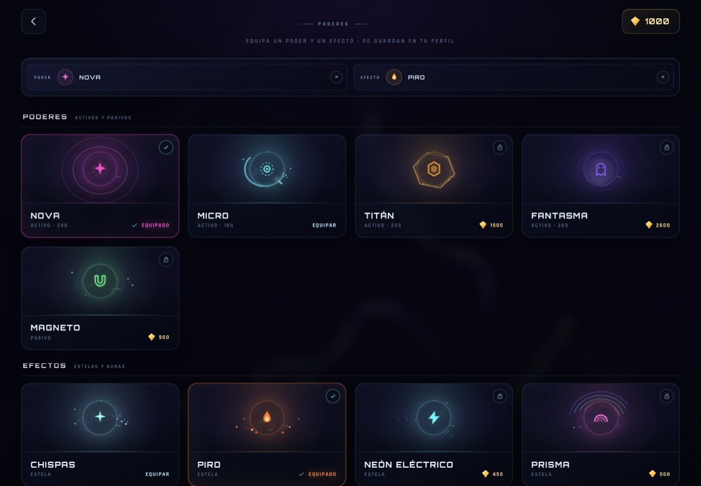

# WORMZILLA

**Devora. Crece. Domina.** Un juego web de serpientes en solitario, con estética de arena orbital, música electrónica generativa, 17 pieles y magia comprable con puntos.

[▶ Jugar online](https://fraguio.com/wormzilla/)


## Cómo jugar

- **Tablet**: apoya un dedo en la pantalla y arrástralo para girar. Al soltar, la serpiente conserva el rumbo. Sin turbo táctil. Las habilidades activas se lanzan con el **botón PODER** que aparece sobre el minimapa.
- **Ratón**: mueve el cursor para girar. Mantén pulsado para turbo. Pulsa **E** para usar el poder activo.
- **Teclado**: flechas o WASD para girar; espacio para turbo; E para poder; Esc para pausa; M para silenciar.

Come orbes para crecer. Si tu cabeza toca el cuerpo de otra serpiente, mueres y sueltas tu masa como botín. Cabeza contra cabeza: ambos caéis. El borde de la arena es letal. Los orbes dorados valen más.

## Pieles

17 tipos de serpiente, cada uno con paleta, patrón, ojos y detalles propios. Cuatro son gratis y el resto se desbloquean con puntos: Neón, Víbora, Ascua, Glitch, Veneno, Nebula, Cromo, Arcoíris, Espectro, Wormzilla, Solaris, Caramelo, Sakura, Zafiro, Ónix, Aurora y Mecha.

## Poderes y efectos

Se compran con puntos y se guardan en el perfil. Puedes equipar **un poder** y **un efecto mágico** a la vez.

- **Nova**: onda expansiva que destruye a las serpientes cercanas y convierte sus cuerpos en botín.
- **Micro**: cuerpo microscópico y velocidad extrema durante unos segundos.
- **Titán**: engrosa tu cuerpo para que los rivales se estrellen contra ti.
- **Fantasma**: atraviesa cuerpos y serpientes sin morir durante unos segundos.
- **Magneto**: atrae orbes desde mucho más lejos. Pasivo.
- **Efectos**: Chispas, Piro, Neón Eléctrico, Prisma, Vacío y Órbita; estelas y auras que envuelven tu serpiente.



## Progreso

Los puntos, las pieles, los poderes y efectos desbloqueados, las selecciones equipadas, el récord, las partidas y las bajas se guardan en `localStorage` del navegador.

## Desarrollo local

No requiere build ni dependencias:

```bash
python3 -m http.server 8000
```

Abre `http://localhost:8000`.

## Tecnología

- Canvas 2D con capa de bloom, partículas, estelas mágicas, cámara suave y efectos de luz.
- Audio 100 % procedural con WebAudio: música deep house generativa y efectos sintetizados.
- IA de serpientes con búsqueda de comida, evasión de cuerpos, caza oportunista y respawn.
- Render adaptado a escritorio, tablet y orientación vertical.
- Manifest + iconos para instalar como web app.

## Créditos

- Diseño y desarrollo: [jfraguio](https://github.com/jfraguio).
- Tipografías: Orbitron y Rajdhani, bajo SIL Open Font License 1.1. Licencias en `assets/fonts/`.
