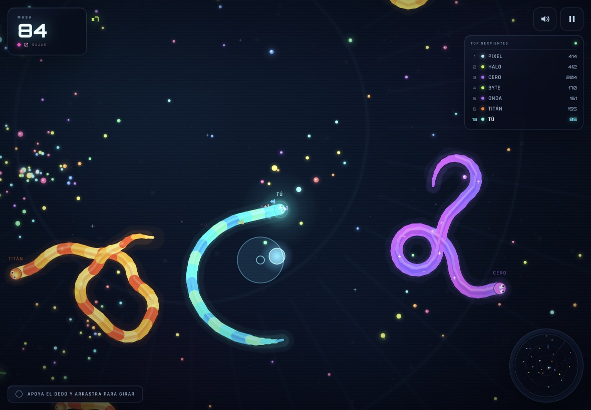

# WORMZILLA

**Devora. Crece. Domina.** Un juego web de serpientes en solitario, con estética de arena orbital, música electrónica generativa y progresión guardada en el navegador.

[▶ Jugar online](https://jfraguio.github.io/wormzilla/)



## Cómo jugar

- **Tablet**: apoya un dedo en la pantalla y arrástralo para girar. Al soltar, la serpiente conserva el rumbo. Sin turbo táctil.
- **Ratón**: mueve el cursor para girar. Mantén pulsado para turbo.
- **Teclado**: flechas o WASD para girar; espacio para turbo; Esc para pausa; M para silenciar.

Come orbes para crecer. Si tu cabeza toca el cuerpo de otra serpiente, mueres y sueltas tu masa como botín. Cabeza contra cabeza: ambos caéis. El borde de la arena es letal. Los orbes dorados valen más.

## Progreso

Los puntos, las pieles desbloqueadas, la piel equipada, el récord, las partidas y las bajas se guardan en `localStorage`. Las pieles bloqueadas se canjean con los puntos ganados en las partidas.

## Desarrollo local

No requiere build ni dependencias:

```bash
python3 -m http.server 8000
```

Abre `http://localhost:8000`.

## Tecnología

- Canvas 2D con capa de bloom, partículas, cámara suave y efectos de luz.
- Audio 100 % procedural con WebAudio: música deep house generativa y efectos sintetizados.
- IA de serpientes con búsqueda de comida, evasión de cuerpos, caza oportunista y respawn.
- Render adaptado a escritorio, tablet y orientación vertical.
- Manifest + iconos para instalar como web app.

## Créditos

- Diseño y desarrollo: [jfraguio](https://github.com/jfraguio).
- Tipografías: Orbitron y Rajdhani, bajo SIL Open Font License 1.1. Licencias en `assets/fonts/`.
